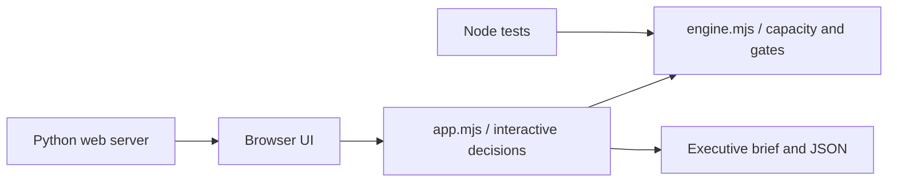

# QualityCommand

### Enterprise QA Management & Release Governance Simulator

**Manage shared QA capacity. Evaluate release risks. Make quality decisions visible.**

**[Overview](#overview)** · **[Business scenario](#business-scenario)** · **[How to use](#how-to-use)** · **[Technical architecture](#technical-architecture)** · **[Model boundaries](#model-boundaries)**

---

## Overview

**QualityCommand** is a standalone interactive enterprise QA management simulation. It models shared QA staff supporting four concurrent releases, with functional and automation workload estimates, test coverage, defect exposure, quality gates, and executive readiness reporting.

> [!IMPORTANT]
> All organizations, projects, staffing numbers, test metrics, defect states, and calculations are **fictional**. Simulated decisions do not represent completed testing or authorization to release software.

## Business scenario

A QA organization has **4 QA leads, 9 functional testers and 4 automation specialists** available to support four concurrent enterprise delivery workstreams:

| Workstream | Time remaining | Key exposure |
|:--|--:|:--|
| Policy Administration Upgrade | 4 weeks | Functional workload, test coverage and missing UAT sign-off |
| Customer Self-Service Portal | 3 weeks | Automation workload and cross-team capacity trade-offs |
| Identity & Access Platform | 5 weeks | Open Sev-1 defect, coverage and outstanding UAT |
| Financial Services API Modernization | 3 weeks | Functional capacity and Sev-2 threshold |

The goal is to allocate limited QA resources responsibly, evaluate delivery interventions, and produce a transparent release-readiness assessment that identifies unresolved gates rather than hiding them.

## How to use

1. **Portfolio:** Review each project's release window, existing coverage, test-pass rate, defect position, and capacity shortfall.
2. **Capacity:** Use the +/− controls to reassign QA leads, functional QA, and automation QA. Watch the global staffing pool: overallocations block readiness.
3. **Decisions:** Choose a workstream and select interventions such as risk-prioritized regression, automation acceleration, controlled scope deferral, or a defect-resolution swarm.
4. **Release governance:** Inspect the resulting work estimates, coverage changes, capacity gaps, approval obligations, and remaining defect gates.
5. **Export:** Download the executive brief or JSON scenario, or print the report.

### Decision interventions

| Decision | Modeled benefit | Important condition |
|:--|:--|:--|
| Risk-prioritized regression | Reduces manual effort by 15% | Lowers modeled coverage five points; documented exclusions required |
| Automation acceleration | Reduces automation effort by 20% | Adds 20 hours of manual validation and review |
| Defer low-risk scope | Reduces manual effort by 20% | Formal change control and sponsor approval required |
| Defect swarm | Models removal of one Sev-2 | Adds 60 hours; closure remains unverified until tested |

## Release-readiness model

The engine calculates estimated available testing hours as `assigned people × productive hours/week × remaining weeks`. It compares capacity with estimated remaining work by discipline, and evaluates sample release criteria:

- No open **Sev-1** defects; no more than two modeled **Sev-2** defects.
- Test coverage at least **90%** and observed pass rate at least **95%**.
- Approved business UAT, assigned QA lead, and no staffing over-allocation.
- No unresolved workload gap or unapproved scenario intervention.

If a gate is violated, the workstream is marked **NOT READY**. Even when modeled minimums are met, the outcome is **CONDITIONAL REVIEW**, not automatic authorization.

## Technical architecture

| File | Purpose |
|:--|:--|
| `index.html`, `styles.css` | Responsive dashboard and accessible controls |
| `app.mjs` | Browser state, resource assignments, scenario decisions and exports |
| `engine.mjs` | Pure deterministic allocation, effort, coverage and readiness calculations |
| `tests/engine.test.mjs` | Automated regression tests for capacity and release-gate behavior |
| `server.py` | Zero-dependency Python web server for hosting |
| `.github/workflows/test.yml` | Test execution on pushes and pull requests |

## Model validation

The current suite contains **16 automated tests**, including an exhaustive 16-combination check for each workstream's four decision options. Tests cover resource shortages, overallocation, defect gates, coverage impacts, scope approvals, and state isolation.

## Model boundaries

This is a **deterministic simulation** intended to make management trade-offs explicit. It does not model workforce skills and availability by day, regulatory certification, vendor constraints, defect arrival rates, calendar holidays, cross-project synchronization, stochastic release risk, or actual project delivery commitments.

Remaining test work estimates and capacity assumptions are editable **only through the source model in this version**; the live UI allows changes to assignments and interventions. Defect-reduction choices are hypothetical until independently validated. This tool does not replace an authorized quality-management system or release board.

---

**QualityCommand** · Enterprise QA portfolio management, capacity planning and release governance

Independent fictional project · No confidential client or organizational data

